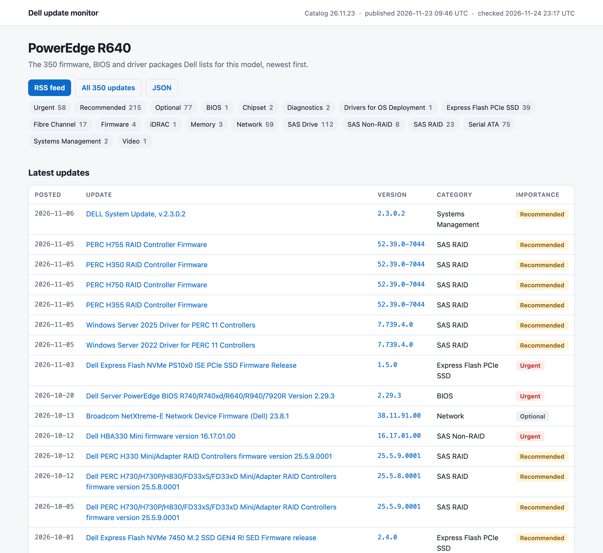
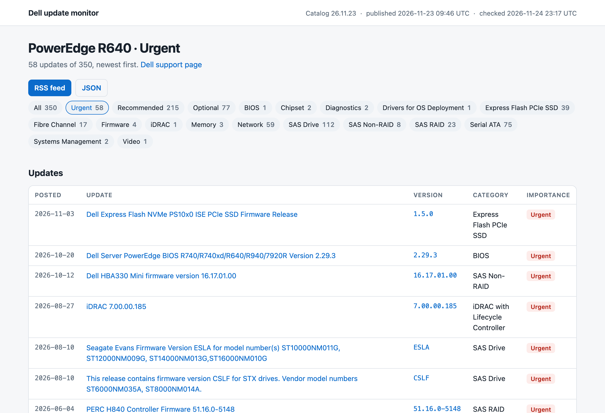

# dell-rss

Monitors Dell's enterprise update catalog
([`Catalog.xml.gz`](https://downloads.dell.com/catalog/Catalog.xml.gz)) and
publishes firmware, BIOS and driver updates for every PowerEdge model as RSS
feeds, a JSON API and an HTML dashboard.

The service makes one catalog download, shared by every model. Refreshes are
conditional (`If-None-Match` / `If-Modified-Since`), so an unchanged catalog
costs a single 304. The last good catalog is kept on disk, so after a restart
the service starts serving straight away.

<picture>
  <source media="(prefers-color-scheme: dark)" srcset="docs/screenshots/dashboard-dark.png">
  
</picture>

<details>
<summary>A filtered model page (<code>/r640/urgent/</code>)</summary>
<br>
<picture>
  <source media="(prefers-color-scheme: dark)" srcset="docs/screenshots/model-dark.png">
  
</picture>
</details>

The dashboard follows the system light or dark setting. The screenshots show
the live catalog on 2026-11-24.

## Endpoints

| Endpoint                     | Purpose                                                    |
| ---------------------------- | ---------------------------------------------------------- |
| `/`                          | HTML dashboard: default model's latest updates, all models |
| `/{model}/`                  | Model dashboard, e.g. `/r640/`                             |
| `/{model}/{filter}/`         | Filtered model dashboard, e.g. `/r640/urgent/`             |
| `/rss.xml`                   | Feed for the default model (`DELL_MODEL`)                  |
| `/{model}/rss.xml`           | Feed for one model, e.g. `/r740/rss.xml`                   |
| `/{model}/{filter}/rss.xml`  | Filtered feed, e.g. `/r640/bios/rss.xml`                   |
| `/api/models`                | Discovered models, with update counts and feed links       |
| `/api/{model}`               | JSON updates for a model, plus its available filters       |
| `/api/{model}/{filter}`      | Filtered JSON updates                                      |
| `/healthz`                   | `200` once a catalog is loaded, `503` before               |
| `/metrics`                   | Prometheus metrics                                         |

Model names are case- and space-insensitive: `R650 XS` is `/r650xs/`.

**Filters**

- By importance: `urgent`, `recommended`, `optional`.
- By category: the category name as a slug, for example `bios`, `network`,
  `sas-raid`, `fibre-channel` or `systems-management`. `idrac` is an alias for
  `idrac-with-lifecycle-controller`.

`/api/{model}` lists the filters that apply to a model. A filter that exists
but has no updates for that model gives an empty feed rather than a 404, so
you can subscribe to it before anything is posted.

Feeds and JSON send a strong `ETag` and a `Last-Modified` header (the date of
the catalog), and answer conditional requests with `304 Not Modified`. ETags
depend only on the catalog's contents, so they stay valid across restarts.

## Configuration

| Variable           | Default                                            | Notes                                                   |
| ------------------ | -------------------------------------------------- | ------------------------------------------------------- |
| `DELL_MODEL`       | `R640`                                             | Model served at `/rss.xml` and on the dashboard         |
| `REFRESH_INTERVAL` | `6h`                                               | Go duration, minimum `1m`; failures retry from 30s with backoff |
| `PORT`             | `8088`                                             |                                                         |
| `CACHE_DIR`        | `/data` in the image, else the user cache dir      | `off` disables persistence                              |
| `PUBLIC_URL`       | unset                                              | e.g. `https://dell-rss.example.com`; adds `atom:link rel="self"` |
| `DELL_BRANDS`      | `PowerEdge,Enterprise Servers`                     | Catalog brands to index; Dell files 13G PowerEdge (R630, R730…) under *Enterprise Servers* |
| `CATALOG_URL`      | `https://downloads.dell.com/catalog/Catalog.xml.gz` |                                                         |
| `LOG_LEVEL`        | `info`                                             | `debug` also logs `/healthz` and `/metrics` requests    |
| `LOG_FORMAT`       | `json`                                             | `text` for a terminal                                   |

## Running

```sh
docker compose up -d
```

Or use the published image (`linux/amd64` and `linux/arm64`):

```sh
docker run -d -p 8088:8088 -v dell-rss-cache:/data ghcr.io/dragonsecurity/dell-rss:latest
```

The image is `distroless/static`. It runs as a non-root user, works with a
read-only root filesystem, and has a built-in `HEALTHCHECK` (`dell-rss
healthcheck`). On `SIGTERM` it drains in-flight requests for up to 15s.

Locally:

```sh
LOG_FORMAT=text go run .
go test -race ./...
```

## Metrics

| Series                                                 | Type      |
| ------------------------------------------------------ | --------- |
| `dell_rss_catalog_refreshes_total{result}`             | counter (`success`, `not_modified`, `error`) |
| `dell_rss_catalog_downloaded_bytes_total`              | counter   |
| `dell_rss_catalog_refresh_duration_seconds`            | gauge     |
| `dell_rss_catalog_last_attempt_timestamp_seconds`      | gauge     |
| `dell_rss_catalog_last_success_timestamp_seconds`      | gauge     |
| `dell_rss_catalog_modified_timestamp_seconds`          | gauge     |
| `dell_rss_catalog_components`, `dell_rss_models`       | gauge     |
| `dell_rss_http_requests_total{route,code}`             | counter   |
| `dell_rss_http_request_duration_seconds{route}`        | histogram |
| `dell_rss_build_info{version,goversion}`               | gauge     |

`route` comes from a fixed set (`model_rss`, `filter_rss`, `api_model`, …), so
label cardinality does not grow with the number of models.

An alert worth having:
`time() - dell_rss_catalog_last_success_timestamp_seconds > 86400`.

## Releases

GitHub Actions runs gofmt, vet and race-enabled tests on every push and pull
request, then builds the image for both architectures. Images are pushed to
GHCR as follows:

- a push to `main` is tagged `edge` and `sha-<short>`;
- a `vX.Y.Z` tag is tagged `X.Y.Z`, `X.Y` and `latest`.

Pull requests build the image but push nothing.

## Layout

```
main.go                  config, refresh loop with backoff, graceful shutdown
internal/catalog         streaming UTF-16/UTF-8 parser; conditional fetch + disk cache
internal/feed            model discovery, filters, RSS and JSON rendering
internal/server          routing, ETag/Last-Modified, dashboard templates
internal/metrics         dependency-free Prometheus exposition
```

## License

Apache License 2.0. See [LICENSE](LICENSE).
